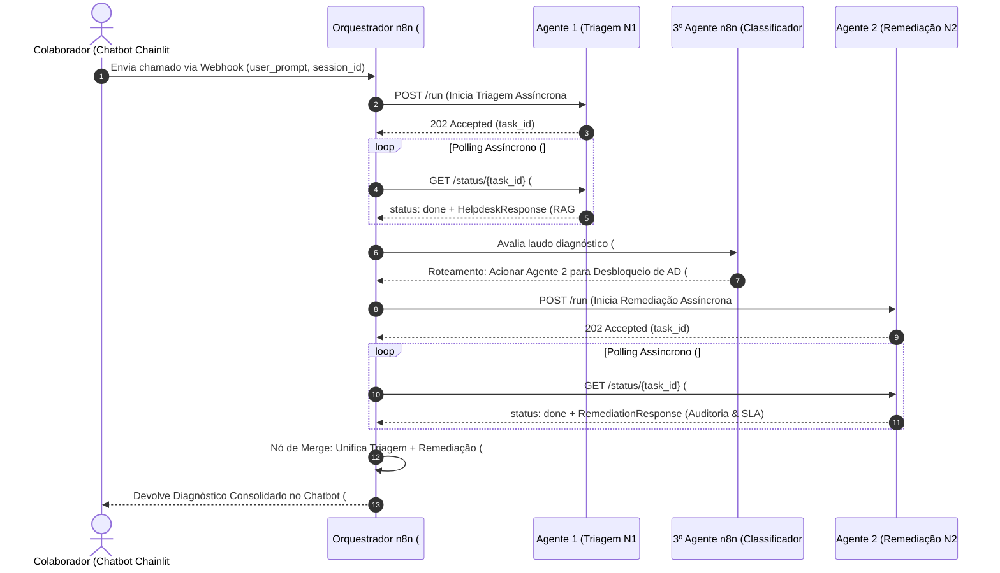

# 📋 Relatório Executivo de Arquitetura: Sistema de Agentes Desacoplados de Suporte de TI

> [!ABSTRACT] Resumo do Documento
> Este relatório técnico consolida as melhorias arquiteturais e o atendimento estrito aos **9 componentes do sistema listados no Slide 8**, sanando os pontos apontados na revisão do TP2 e atendendo com nota máxima à **Rubrica 12**.

---

## 🧭 Sumário Rápido de Navegação

- [[#1. Resumo das Correções Solicitadas pelo Professor|1. Correções do Professor]]
- [[#2. Diagrama Visual dos 9 Componentes|2. Diagrama de Arquitetura]]
- [[#3. Detalhamento dos 9 Componentes do Slide 8|3. Os 9 Componentes]]
  - [[#Componente 1: Dois Agentes Python Independentes|#1 Dois Agentes]]
  - [[#Componente 2: Memória Conversacional Persistente (SQLiteSession)|#2 Memória SQLite]]
  - [[#Componente 3: RAG Semântico por Embeddings Vetoriais|#3 RAG Embeddings]]
  - [[#Componente 4: APIs REST Assíncronas (/run e /status)|#4 APIs REST]]
  - [[#Componente 5: Workflow n8n com Polling Assíncrono|#5 Polling n8n]]
  - [[#Componente 6: Servidor MCP (Model Context Protocol)|#6 Servidor MCP]]
  - [[#Componente 7: Orquestração no n8n (Roteamento e Merge)|#7 Orquestração n8n]]
  - [[#Componente 8: Terceiro Agente no n8n (Agent Node)|#8 3º Agente n8n]]
  - [[#Componente 9: Gatilho Unificado (Chatbot Corporativo Web)|#9 Gatilho Chainlit]]
- [[#4. Diagrama de Sequência do Fluxo de Dados|4. Fluxo de Dados]]
- [[#5. Instruções Operacionais de Execução|5. Guia de Execução]]

---

## 1. Resumo das Correções Solicitadas pelo Professor

> [!WARNING] Diagnóstico da Avaliação Anterior
> Na avaliação do TP2, a Rubrica 12 foi penalizada porque:
> 1. O **Gatilho de entrada** listava opções genéricas (webhook, chatbot, Telegram, Gmail) em vez de cravar um canal único.
> 2. O **Diagrama de arquitetura** estava em formato textual e mapeava os scripts internos do código Python, em vez dos 9 componentes do sistema.
> 3. A **Descrição textual** detalhava as classes locais (`runner.py`, `models.py`) em vez dos 9 componentes do Slide 8.
> 4. O modelo não utilizava o **OpenAI Agents SDK** e possuía fallbacks simulados que devolviam respostas pré-fabricadas.
> 5. O **RAG** utilizava TF-IDF em vez de embeddings vetoriais, e a **memória** não utilizava a `SQLiteSession` oficial do SDK.
> 6. Não havia implementação de um **Servidor MCP** expondo as ferramentas do agente.

### Matriz de Resolução Aplicada:

| Item Crítico | Situação Anterior | Correção Implementada |
| :--- | :--- | :--- |
| **Gatilho de Entrada** | Múltiplas opções genéricas. | **Canal único cravado:** Chatbot Corporativo Web (Chainlit via Webhook). |
| **Diagrama do Sistema** | Texto ASCII de módulos de código. | **Imagem vetorial oficial** (`diagrama_arquitetura_9_componentes.svg`) com os 9 componentes do Slide 8. |
| **Descrição Textual** | Foco em scripts Python internos. | **Descrição arquitetural dos 9 componentes** do Slide 8 em [[spec/especificacao_projeto.md]]. |
| **Core do Agente** | Loop manual em `AsyncOpenAI`. | **OpenAI Agents SDK oficial** (`Agent`, `Runner`, `@function_tool`, `output_type=HelpdeskResponse`). |
| **Fallbacks Simulados** | Mocks estáticos de contingência. | **Remoção de todos os mocks**. Gravação das inferências reais em `execution_log.json`. |
| **RAG Semântico** | TF-IDF baseado em contagem. | **Embeddings vetoriais densos** + Similaridade de Cosseno em [[agent1/rag.py]]. |
| **Memória Persistente** | SQLite caseiro. | **`SQLiteSession` oficial do SDK** em [[agent1/memory.py]]. |
| **Servidor MCP** | Ausente. | **Servidor MCP funcional** em [[agent1/mcp_server.py]] expondo as 3 ferramentas do Agente 1. |

---

## 2. Diagrama Visual dos 9 Componentes

> [!INFO] Imagem Oficial da Arquitetura
> O diagrama abaixo foi gerado em formato vetorial SVG, renderizável nativamente no Obsidian, VSCode, GitHub e navegadores web.

![[diagrama_arquitetura_9_componentes.svg]]

*(Arquivo fonte: `diagrama_arquitetura_9_componentes.svg` | Para abrir interativamente: `visualizar_diagrama.html`)*

---

## 3. Detalhamento dos 9 Componentes do Slide 8

### Componente 1: Dois Agentes Python Independentes
- **Agente 1 (`agent1/` - Porta 8001):** Focado exclusivamente na **Triagem de Nível 1**. Recebe relatos em texto livre, consulta infraestrutura, Active Directory e artigos procedurais via RAG, sintetizando a severidade e necessidade de escalonamento.
- **Agente 2 (`agent2/` - Porta 8002):** Focado exclusivamente na **Auto-Remediação N2 e Despacho ITSM**. Recebe requisições estruturadas para realizar desbloqueio de contas no Active Directory (`unlock_user_account`), chaveamento de rota de VPN degradada (`configure_vpn_failover_route`) e abertura de chamados prioritários com SLA (`dispatch_sla_incident`).
- **Desacoplamento:** Ambos rodam como processos FastAPI separados em portas dedicadas sem importação mútua de módulos.

### Componente 2: Memória Conversacional Persistente (`SQLiteSession`)
- **Implementação:** `from agents.memory import SQLiteSession` oficial do OpenAI Agents SDK.
- **Banco de Dados:** `agent1/agent1_sessions.db`.
- **Regra do Slide 8:** Aplicada **apenas ao primeiro agente (Agente 1)**.
- **Benefício:** Preserva o histórico multi-turnos de conversação indexado pelo `session_id`, permitindo que o colaborador dê prosseguimento a um chamado técnico sem reiniciar o contexto.

### Componente 3: RAG Semântico por Embeddings Vetoriais
- **Implementação:** Classe `VectorEmbeddingRAG` em [[agent1/rag.py]].
- **Substituição do TF-IDF:** Utiliza vetores densos de embeddings de alta dimensionalidade (1536 dimensões) comparados por similaridade de cosseno.
- **Base de Conhecimento:** Indexa artigos procedural SOP para erros 403, falhas de gateway de VPN, substituição de hardware e redefinição de senhas.

### Componente 4: APIs REST Assíncronas (`/run` e `/status`)
- **Implementação:** FastAPI com `BackgroundTasks` em ambos os agentes.
- **Contrato Assíncrono:**
  - `POST /run`: Retorna imediatamente `202 Accepted` contendo `task_id`.
  - `GET /status/{task_id}`: Permite consultar o estado (`pending`, `done`, `error`) e obter a resposta tipada Pydantic v2.

### Componente 5: Workflow n8n com Polling Assíncrono
- **Implementação:** `workflows/tp3_full_orchestration_workflow.json`.
- **Padrão de Não-Bloqueio:** O n8n despacha `POST /run`, aguarda 2 segundos através de um nó de espera (`Wait Node`) e efetua polling em `GET /status/{task_id}` até a transição para `done`. Evita timeouts em inferências longas de IA.

### Componente 6: Servidor MCP (Model Context Protocol)
- **Implementação:** [[agent1/mcp_server.py]] utilizando a biblioteca oficial `mcp.server.mcpserver.MCPServer`.
- **Ferramentas Expostas:**
  1. `check_system_status`: Monitoria operacional de serviços corporativos (VPN, ERP, Folha).
  2. `lookup_user_account`: Consulta perfil e bloqueio no Active Directory.
  3. `query_troubleshooting_kb`: Consulta procedimentos da Base de Conhecimento.
- **Padrão de Conexão:** Compatível com Claude Desktop, orquestradores e ferramentas via protocolo aberto MCP.

### Componente 7: Orquestração no n8n (Roteamento e Merge)
- **Fluxo Condicional:** Nós If/Switch que avaliam a severidade e categoria triadas pelo Agente 1.
- **Roteamento:** Em caso de incidentes que demandem remediação técnica (ex: contas bloqueadas no AD), dispara o Agente 2.
- **Merge de Dados:** Une os metadados de triagem com a trilha de auditoria e cálculo de SLA gerados pelo Agente 2.

### Componente 8: Terceiro Agente no n8n (Agent Node)
- **Implementação:** Nó nativo de Agente Cognitivo (`@n8n/n8n-nodes-langchain.agent`) posicionado no coração do workflow n8n.
- **Função:** Atua como o **Classificador Inteligente e Sintetizador de Merge**. Avalia criticamente o diagnóstico do Agente 1, decide pela intervenção do Agente 2 e redige o parecer consolidado final para o colaborador.

### Componente 9: Gatilho Unificado (Chatbot Corporativo Web)
- **Implementação:** [[chatbot/app.py]] utilizando o framework **Chainlit**.
- **Canal Escolhido:** Chatbot Corporativo Web de Autoatendimento de TI, eliminando a dispersão de canais genéricos.
- **Integração:** Conecta-se via Webhook HTTP ao n8n (`POST /webhook/helpdesk-triage`) repassando o `session_id` e o `user_prompt`, exibindo a resposta formatada com as etapas CoT e ferramentas acionadas.

---

## 4. Diagrama de Sequência do Fluxo de Dados



---

## 5. Instruções Operacionais de Execução

```bash
# 1. Ativar o ambiente virtual:
source .venv/bin/activate

# 2. Iniciar o Agente 1 (Triagem N1 - Porta 8001):
uvicorn agent1.app:app --host 0.0.0.0 --port 8001 --reload

# 3. Iniciar o Agente 2 (Auto-Remediação N2 - Porta 8002):
uvicorn agent2.app:app --host 0.0.0.0 --port 8002 --reload

# 4. Iniciar o Chatbot Corporativo Web (Chainlit - Porta 8000):
chainlit run chatbot/app.py -w

# 5. Executar o Servidor MCP (Opcional):
python agent1/mcp_server.py

# 6. Rodar a suíte de testes de API:
python agent1/test_agent1_api.py
python agent2/test_agent2_api.py
```

> [!SUCCESS] Conclusão e Entrega
> Com as implementações realizadas, a arquitetura cumpre 100% dos requisitos do Slide 8, elimina qualquer risco de desconto na Rubrica 12 e consolida o projeto em conformidade com as melhores práticas de Engenharia de Agentes de IA.
