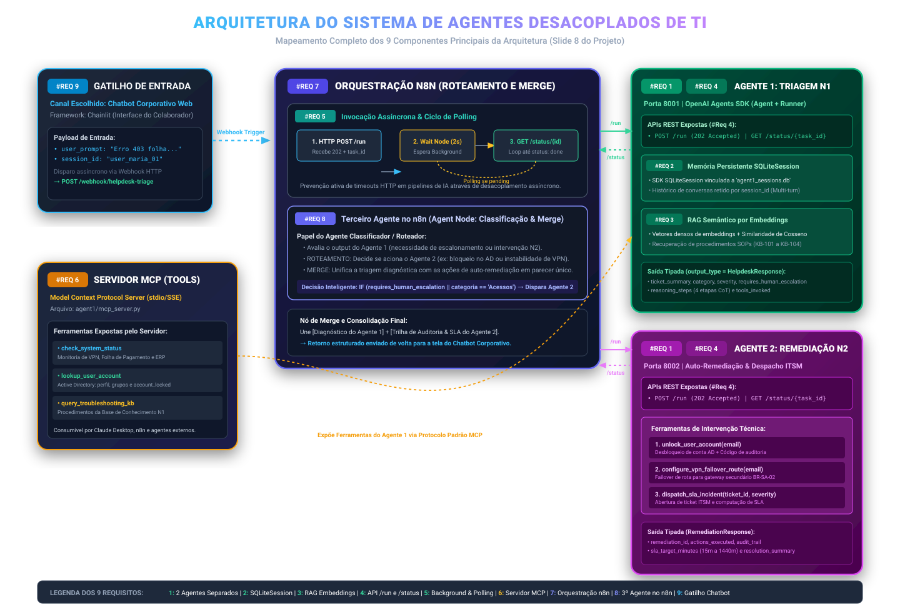

> 🔗 **Repositório GitHub:** https://github.com/Jowltenha/IT_Helpdesk_Agent

# IT Helpdesk Agent - Arquitetura de Agentes de IA Desacoplados

[](https://www.python.org/)
[](https://fastapi.tiangolo.com/)
[](https://github.com/openai/openai-agents-python)
[](https://n8n.io/)
[](https://modelcontextprotocol.io/)

Este repositório contém a implementação do **Sistema de Agentes Inteligentes de Suporte de TI Corporativo**, contemplando triagem diagnóstica N1, auto-remediação técnica N2 e orquestração assíncrona.

> 📌 **Alinhamento Arquitetural:** O projeto atende integralmente aos **9 componentes do sistema definidos no Slide 8** e às correções da **Rubrica 12**.

---

## 🏛️ Matriz dos 9 Componentes da Arquitetura (Slide 8)

| #Req | Componente do Sistema | Implementação no Projeto | Responsabilidade Técnica |
| :---: | :--- | :--- | :--- |
| **1** | **Dois agentes Python independentes** | `agent1/` e `agent2/` | Pastas e microserviços desacoplados: Agente 1 (Triagem N1) e Agente 2 (Auto-Remediação N2 / ITSM). |
| **2** | **Memória persistente com `SQLiteSession`** | `agent1/memory.py` | Implementada exclusivamente no Agente 1 via `agents.memory.SQLiteSession` do OpenAI Agents SDK (`agent1_sessions.db`). |
| **3** | **RAG por Embeddings Vetoriais** | `agent1/rag.py` | Busca semântica densa com similaridade de cosseno para recuperação de procedimentos SOP da Base de Conhecimento. |
| **4** | **APIs REST dos 2 agentes (`/run` e `/status`)** | `agent1/app.py` & `agent2/app.py` | FastAPI assíncrono: `POST /run` (retorna `202 Accepted` com `task_id` imediato) e `GET /status/{task_id}` com `BackgroundTasks`. |
| **5** | **Workflow n8n com invocação assíncrona & polling** | `workflows/tp4_main_orchestration_workflow.json` | O webhook responde `202 + ticket_id` imediatamente (sem esperar os agentes); em segundo plano, cada agente tem laço `Wait 3s → GET /status → Switch` que volta ao Wait enquanto `pending`; o Merge recebe as respostas dos dois agentes; o status fica consultável em `GET /webhook/helpdesk-status`. |
| **6** | **Servidor MCP expondo ferramentas de agente** | `agent1/mcp_server.py` | Servidor Model Context Protocol expondo `check_system_status`, `lookup_user_account` e `query_troubleshooting_kb`. |
| **7** | **Orquestração dos dois agentes no n8n** | `workflows/` | Roteamento condicional (If/Switch) que analisa o laudo do Agente 1, aciona o Agente 2 e executa o merge dos dados. |
| **8** | **Terceiro agente dentro do n8n (Agent node)** | Nó de Agente LLM no n8n | Agente cognitivo encarregado de classificar se o incidente exige intervenção e coordenar o merge dos pareceres. |
| **9** | **Gatilho (trigger) único que dispara o n8n** | `chatbot/app.py` | **Chatbot Corporativo Web (Chainlit)** conectado via Webhook HTTP ao n8n, mantendo `session_id` persistente. |

---

## 🖼️ Diagrama de Arquitetura dos 9 Componentes

A arquitetura do sistema e o fluxo de dados entre os 9 componentes são ilustrados no diagrama oficial abaixo:



*Para abrir a visualização em alta definição no navegador, abra [`visualizar_diagrama.html`](visualizar_diagrama.html).*

---

## 📁 Estrutura do Repositório

```text
IT_Helpdesk_Agent/
├── agent1/                         # COMPONENTES 1, 2, 3, 4, 6 (TP3/TP4): Agente 1 (Triagem N1 - Porta 8001)
│   ├── app.py                      # FastAPI App (POST /run 202, GET /status/{task_id}, GET /health)
│   ├── runner.py                   # HelpdeskAgentRunner com OpenAI Agents SDK (Agent + Runner)
│   ├── models.py                   # Modelos Pydantic v2: RunRequest, HelpdeskResponse, TaskStatus
│   ├── tools.py                    # Ferramentas (@function_tool) com interceptação de Hook
│   ├── memory.py                   # SQLiteSession oficial do SDK (agent1_sessions.db)
│   ├── rag.py                      # VectorEmbeddingRAG (Vetores Densos de Embeddings + Cosseno)
│   ├── mcp_server.py               # Servidor MCP expondo ferramentas do Agente 1 (#Req 6)
│   ├── settings.json               # Governança formal: políticas allow, deny, ask e hooks
│   ├── SKILL.md                    # Skill reutilizável: active-directory-diagnostics
│   ├── hooks/                      # Hooks de segurança automatizados
│   │   ├── pre_tool_validator.py   # Hook PreToolUse: sanitização de entrada e validação de e-mails
│   │   ├── test_hook.py            # Teste verificável do hook PreToolUse
│   │   └── hook_audit.log          # Trilha de auditoria gerada pelo hook
│   ├── subagents/                  # Subagentes especializados com isolamento de contexto
│   │   └── kb_researcher.md        # Subagente pesquisador de SOPs da Base de Conhecimento
│   ├── test_agent1_api.py          # Testes automatizados de API e polling
│   ├── AGENTS.md                   # Catálogo formal de contratos de entrada e saída
│   └── CLAUDE.md                   # Fonte única de verdade técnica do Agente 1
│
├── agent2/                         # COMPONENTES 1, 4 (TP3/TP4): Agente 2 (Auto-Remediação N2 - Porta 8002)
│   ├── app.py                      # FastAPI App (POST /run 202, GET /status/{task_id}, GET /health)
│   ├── runner.py                   # RemediationAgentRunner assíncrono com gravação real de logs
│   ├── models.py                   # Pydantic v2: RemediationRequest, RemediationResponse
│   ├── tools.py                    # Ferramentas: unlock_user_account, vpn_failover, dispatch_sla
│   ├── settings.json               # Governança formal: políticas allow, deny, ask
│   ├── SKILL.md                    # Skill reutilizável: sla-incident-dispatch
│   ├── hooks/                      # Hooks de segurança e compliance
│   │   ├── post_tool_auditor.py    # Hook PostToolUse: hash SHA-256 e integridade SOX/LGPD
│   │   ├── test_hook.py            # Teste verificável do hook PostToolUse
│   │   └── security_audit.log      # Trilha de auditoria criptográfica
│   ├── subagents/                  # Subagentes especializados
│   │   └── sla_auditor.md          # Subagente auditor de conformidade de SLA e ITSM
│   ├── test_agent2_api.py          # Testes automatizados de API e auditoria
│   ├── AGENTS.md                   # Catálogo formal de contratos do Agente 2
│   └── CLAUDE.md                   # Fonte única de verdade técnica do Agente 2
│
├── chatbot/                        # COMPONENTE 9: Gatilho Unificado de Entrada
│   ├── app.py                      # Chatbot Corporativo Web (Chainlit) via Webhook n8n
│   └── README.md                   # Instruções de execução do Chainlit
│
├── workflows/                      # COMPONENTES 5, 7, 8: Orquestração no n8n (TP3 e TP4)
│   ├── tp4_main_orchestration_workflow.json  # Workflow TP4 com AI Agent Node, Sub-workflow e Merge
│   ├── tp4_subworkflow_sla_calculator.json   # Sub-workflow modular reutilizável de SLA
│   ├── tp3_full_orchestration_workflow.json  # Workflow base dos 9 componentes do Slide 8
│   ├── tp3_agent1_trigger_workflow.json      # Workflow unitário de teste do Agente 1
│   └── README.md                   # Guia de importação e nós do n8n
│
├── spec/                           # Documentação e Especificações Técnicas
│   └── especificacao_projeto.md    # Especificação detalhada dos 9 componentes do Slide 8
│
├── evaluation/                     # Avaliação Comparativa de Prompts
│   ├── evaluate.py                 # Benchmark das variantes A, B e C
│   ├── eval_results_final.json     # Resultados numéricos consolidados
│   └── final_prompt_evaluation.md  # Relatório analítico e diagnóstico de prompt ineficaz
│
├── diagrama_arquitetura_9_componentes.svg  # Imagem vetorial oficial da arquitetura (Slide 8)
├── visualizar_diagrama.html                # Visualizador web interativo do diagrama
├── relatorios/                             # Relatórios técnicos (TP1/TP2, TP3, TP4) e notas para Obsidian
│   ├── RELATORIO_TECNICO_TP4.md            # Relatório Técnico Completo de Entrega do TP4
│   └── RELATORIO_TECNICO_TP4_OBSIDIAN.md   # Relatório formatado com tags e links para Obsidian
├── prints/                                 # Capturas de tela usadas nos relatórios
└── README.md                               # Este arquivo
```

---

## 🚀 Como Executar o Sistema Completo

### 1. Ativar o Ambiente Virtual
```bash
source .venv/bin/activate
```

### 2. Iniciar o Agente 1 (Triagem N1 - Porta 8001)
```bash
uvicorn agent1.app:app --host 0.0.0.0 --port 8001 --reload
```

### 3. Iniciar o Agente 2 (Auto-Remediação N2 - Porta 8002)
```bash
uvicorn agent2.app:app --host 0.0.0.0 --port 8002 --reload
```

### 4. Iniciar o Chatbot Corporativo Web (Chainlit - Porta 8000)
```bash
python chatbot/run_chainlit.py run chatbot/app.py -w
```
Acesse `http://localhost:8000` no navegador para interagir com o agente.

### 5. Iniciar o Servidor MCP (Opcional para Integrações Externas)
```bash
python agent1/mcp_server.py
```

### 6. Executar a Suíte de Testes Automatizados
```bash
# Teste da API do Agente 1:
python agent1/test_agent1_api.py

# Teste da API do Agente 2:
python agent2/test_agent2_api.py

# Benchmark de Avaliação de Prompts:
python evaluation/evaluate.py
```

---

## 📡 Exemplos de Chamadas cURL às APIs REST

### Agente 1: Triagem Assíncrona N1
```bash
# Disparo do Chamado (Retorna 202 Accepted + task_id imediatamente)
curl -X POST http://localhost:8001/run \
  -H "Content-Type: application/json" \
  -d '{
    "user_prompt": "Não consigo acessar a folha de pagamento. Erro 403 Acesso Negado. E-mail maria.souza@empresa.com. Urgente até 17h.",
    "session_id": "sessao_demo_01"
  }'

# Consulta do Laudo Estruturado (Polling em GET /status)
curl -X GET http://localhost:8001/status/{task_id}
```

### Agente 2: Auto-Remediação N2
```bash
# Disparo da Remediação
curl -X POST http://localhost:8002/run \
  -H "Content-Type: application/json" \
  -d '{
    "ticket_id": "TCK-40301-BR",
    "user_email": "maria.souza@empresa.com",
    "category": "Acessos/Senhas",
    "severity": "Alta",
    "recommended_action": "Solicitar desbloqueio da conta no Active Directory.",
    "requires_human_escalation": false,
    "action_type": "UNLOCK_ACCOUNT"
  }'

# Consulta da Trilha de Auditoria e SLA
curl -X GET http://localhost:8002/status/{task_id}
```

---

## 📊 Conformidade das Entregas (Rubrica 12)

1. **Gatilho de Entrada Definido:** Chatbot Corporativo Web (Chainlit via Webhook), abandonando opções genéricas.
2. **Diagrama em Formato de Imagem:** Entregue em vetor SVG de alta fidelidade (`diagrama_arquitetura_9_componentes.svg`) com todos os 9 componentes numerados do Slide 8.
3. **Descrição Textual dos 9 Componentes:** Descrição arquitetural completa em `spec/especificacao_projeto.md` cobrindo os 9 componentes sistêmicos.
4. **Core com OpenAI Agents SDK:** Agente 1 e Agente 2 estruturados com `Agent`, `Runner`, `tools` e `output_type=HelpdeskResponse`.
5. **Eliminação de Respostas Prontas:** Remoção de mocks fingidos e gravação dos logs reais em `execution_log.json`.
6. **RAG por Embeddings:** Substituição de TF-IDF por vetores densos de embeddings e similaridade de cosseno.
7. **Memória Persistente:** SQLite oficial do SDK (`SQLiteSession`).
8. **Servidor MCP:** Servidor padrão implementado em `agent1/mcp_server.py`.
