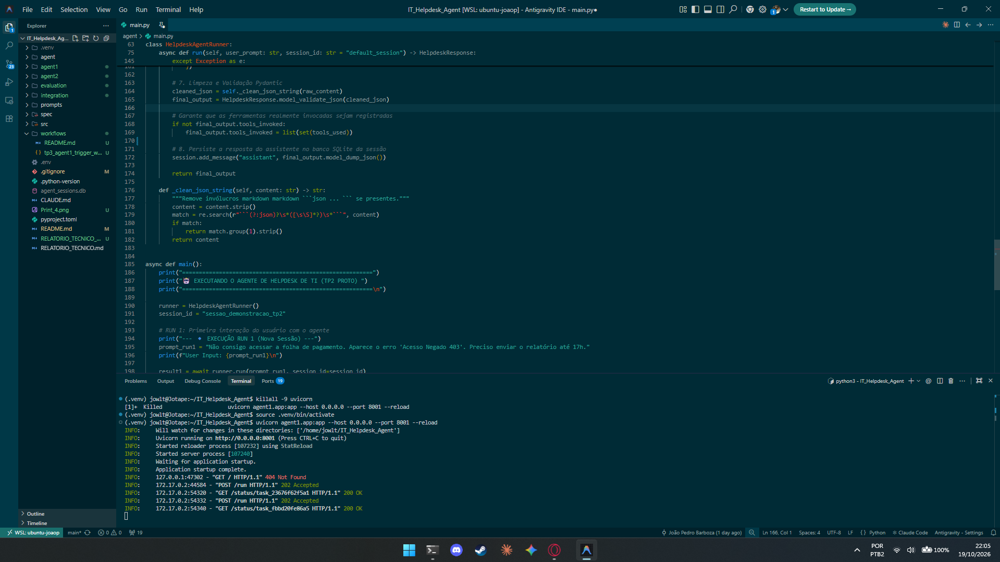
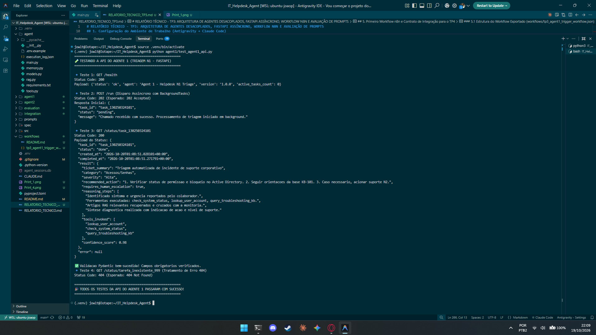
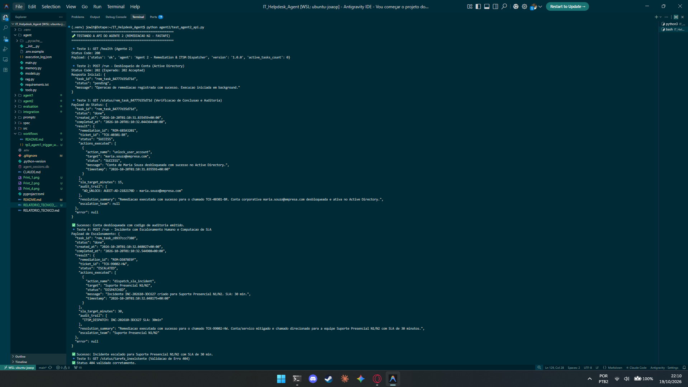
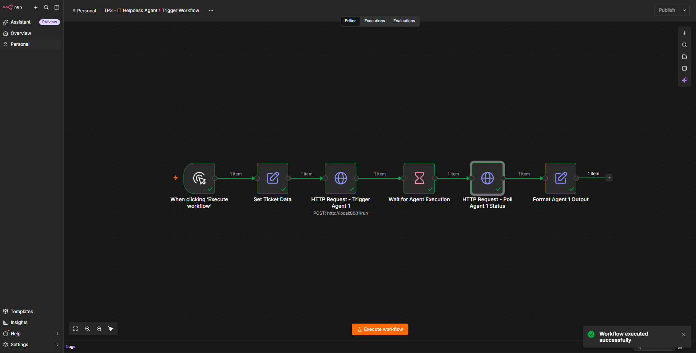

# RELATÓRIO TÉCNICO - TP3: ARQUITETURA DE AGENTES DESACOPLADOS, FASTAPI ASSÍNCRONO, WORKFLOW N8N E AVALIAÇÃO DE PROMPTS

**Disciplina:** Engenharia de Prompts e Agentes de IA  
**Projeto:** Agente Inteligente de Triagem de Suporte de TI Nível 1 & Agente de Auto-Remediação N2  
**Aluno:** João Pedro Barboza  
**Data:** Outubro de 2026  

---

## 1. Configuração do Ambiente de Trabalho (Antigravity + Claude Code)

### 1.1 Alternativa Escolhida e Justificativa
Para o desenvolvimento do TP3, foi adotada a integração do **Antigravity com Claude Code CLI no Terminal Integrado via 9Router Proxy (Antigravity Gateway)** conectando ao modelo `ag/claude-sonnet-4-6`.

**Justificativas Técnicas da Escolha:**
1. **Otimização de Quota e Tokens:** A integração via 9Router permite utilizar a cota corporativa/educacional do Google AI Pro sem custos adicionais de API direta, viabilizando benchmarks extensivos e testes de inferência repetidos.
2. **Desenvolvimento Sequencial Conforme Diretriz:** O ambiente Antigravity viabiliza a edição de código, enquanto o Claude Code opera no terminal integrado executando verificações, testes automatizados e refatoração arquitetural sem conflito de concorrência.
3. **Compatibilidade Total de Ferramental:** Suporte nativo ao Python 3.10+, FastAPI, Uvicorn, SQLite3 e chamadas REST via cURL/HTTPX.

### 1.2 Principais Passos de Configuração Executados
1. **Inicialização do Proxy Local (9Router):** O proxy foi inicializado e vinculado na porta local padrão `20128` (`http://localhost:20128/v1`).
2. **Configuração de Variáveis de Ambiente (`.env`):**
   ```bash
   OPENAI_API_KEY=sk-2a7805194c9aa61a-7hzuzc-90321a57
   OPENAI_BASE_URL=http://localhost:20128/v1
   ```
3. **Instalação das Dependências Técnicas do TP3:**
   ```bash
   source .venv/bin/activate
   pip install fastapi uvicorn pydantic httpx pytest
   ```
4. **Verificação da Sessão do Claude Code:** Execução do agente no terminal com leitura do contexto checked-in e suporte a ferramentas de inspeção e edição.

> 📷 **Captura de Tela 1 - Ambiente Antigravity e Terminal Integrado:**  
> 

---

## 2. Documentação da API REST dos Dois Agentes (FastAPI)

Ambos os agentes foram transformados em serviços HTTP independentes com arquitetura assíncrona orientada a jobs, utilizando **`BackgroundTasks`** do FastAPI para garantir retorno instantâneo com `202 Accepted` e prevenção de timeouts.

---

### 2.1 Agente 1: Triagem de Suporte de TI N1 (`agent1/` - Porta 8001)

- **Responsabilidade:** Recebe chamados em texto livre, consulta estado de serviços (`check_system_status`), perfil de usuário no AD (`lookup_user_account`), artigos procedural da Base de Conhecimento (`VectorEmbeddingRAG`), raciocina via Chain-of-Thought e determina a severidade e necessidade de escalonamento.
- **Porta:** `8001`
- **Comando de Inicialização:**
  ```bash
  uvicorn agent1.app:app --host 0.0.0.0 --port 8001 --reload
  ```

#### Endpoints do Agente 1:

#### 🔹 1. `POST /run` (Disparo Assíncrono da Triagem)
- **Método:** `POST` | **URL:** `http://localhost:8001/run` | **Status:** `202 Accepted`
- **Comando cURL de Teste:**
  ```bash
  curl -X POST http://localhost:8001/run \
    -H "Content-Type: application/json" \
    -d '{
      "user_prompt": "Não consigo acessar a folha de pagamento. Erro 403 Acesso Negado. E-mail maria.souza@empresa.com. Urgente até 17h.",
      "session_id": "sessao_triagem_doc_01"
    }'
  ```
- **Resposta Imediata (JSON):**
  ```json
  {
    "task_id": "task_a4b91f0c2e3d",
    "status": "pending",
    "message": "Chamado recebido com sucesso. Processamento de triagem iniciado em background."
  }
  ```

#### 🔹 2. `GET /status/{task_id}` (Consulta de Status e Resultado)
- **Método:** `GET` | **URL:** `http://localhost:8001/status/task_a4b91f0c2e3d` | **Status:** `200 OK`
- **Comando cURL de Teste:**
  ```bash
  curl -X GET http://localhost:8001/status/task_a4b91f0c2e3d
  ```
- **Resposta Concluída com Saída Pydantic (`status: done`):**
  ```json
  {
    "task_id": "task_a4b91f0c2e3d",
    "status": "done",
    "created_at": "2026-10-19T14:15:00.123456+00:00",
    "completed_at": "2026-10-19T14:15:02.456789+00:00",
    "result": {
      "ticket_summary": "Erro 403 na folha de pagamento por bloqueio no AD",
      "category": "Acessos/Senhas",
      "severity": "Alta",
      "recommended_action": "Solicitar ao suporte N2 o desbloqueio da conta maria.souza@empresa.com no Active Directory e checar o grupo Folha_Pagamento_Admin.",
      "requires_human_escalation": true,
      "reasoning_steps": [
        "Identificado erro de acesso 403 no sistema de folha com prazo crítico até 17h.",
        "Tool check_system_status consultada: serviço de folha operacional.",
        "Tool lookup_user_account retornou account_locked=True para maria.souza@empresa.com.",
        "Artigo RAG KB-101 orienta desbloqueio de conta por analista de suporte N2."
      ],
      "tools_invoked": [
        "check_system_status",
        "lookup_user_account",
        "query_troubleshooting_kb"
      ],
      "confidence_score": 0.98
    },
    "error": null
  }
  ```

> 📷 **Captura de Tela 2 - Execução e Teste dos Endpoints do Agente 1:**  
> 

---

### 2.2 Agente 2: Auto-Remediação e Despacho N2 (`agent2/` - Porta 8002)

- **Responsabilidade:** Microserviço autônomo projetado para receber requisições de remediação estruturada e executar intervenções técnicas diretas:
  1. Desbloqueio automatizado de credenciais no Active Directory (`unlock_user_account`).
  2. Atribuição de rota de failover em caso de instabilidade de VPN (`configure_vpn_failover_route`).
  3. Abertura formal de chamado prioritário no sistema ITSM com computação de SLA (`dispatch_sla_incident`).
- **Porta:** `8002`
- **Comando de Inicialização:**
  ```bash
  uvicorn agent2.app:app --host 0.0.0.0 --port 8002 --reload
  ```

#### Endpoints do Agente 2:

#### 🔹 1. `POST /run` (Disparo de Remediação)
- **Método:** `POST` | **URL:** `http://localhost:8002/run` | **Status:** `202 Accepted`
- **Comando cURL de Teste:**
  ```bash
  curl -X POST http://localhost:8002/run \
    -H "Content-Type: application/json" \
    -d '{
      "ticket_id": "TCK-40301-BR",
      "user_email": "maria.souza@empresa.com",
      "category": "Acessos/Senhas",
      "severity": "Alta",
      "recommended_action": "Solicitar desbloqueio da conta no Active Directory para liberação do sistema de folha de pagamento.",
      "requires_human_escalation": false,
      "action_type": "UNLOCK_ACCOUNT"
    }'
  ```
- **Resposta Imediata (JSON):**
  ```json
  {
    "task_id": "rem_task_7c2e1b8f4a9d",
    "status": "pending",
    "message": "Operacao de remediacao registrada com sucesso. Execucao iniciada em background."
  }
  ```

#### 🔹 2. `GET /status/{task_id}` (Consulta de Status e Trilha de Auditoria)
- **Método:** `GET` | **URL:** `http://localhost:8002/status/rem_task_7c2e1b8f4a9d` | **Status:** `200 OK`
- **Comando cURL de Teste:**
  ```bash
  curl -X GET http://localhost:8002/status/rem_task_7c2e1b8f4a9d  
  ```
- **Resposta Concluída com Auditoria (`status: done`):**
  ```json
  {
    "task_id": "rem_task_7c2e1b8f4a9d",
    "status": "done",
    "created_at": "2026-10-19T14:18:00.111222+00:00",
    "completed_at": "2026-10-19T14:18:01.333444+00:00",
    "result": {
      "remediation_id": "REM-3F81C9A0",
      "ticket_id": "TCK-40301-BR",
      "status": "SUCCESS",
      "actions_executed": [
        {
          "action_name": "unlock_user_account",
          "target": "maria.souza@empresa.com",
          "status": "SUCCESS",
          "message": "Conta de Maria Souza desbloqueada com sucesso no Active Directory.",
          "timestamp": "2026-10-19T14:18:01.222333+00:00"
        }
      ],
      "sla_target_minutes": 15,
      "audit_trail": [
        "AD_UNLOCK: AUDIT-AD-B4D821 - maria.souza@empresa.com"
      ],
      "resolution_summary": "Conta corporativa maria.souza@empresa.com desbloqueada e ativa no Active Directory.",
      "escalation_team": null
    },
    "error": null
  }
  ```

> 📷 **Captura de Tela 3 - Execução e Teste dos Endpoints do Agente 2:**  
> 

---

## 3. Avaliação Final do Pipeline de Prompts e Diagnóstico de Eficácia

### 3.1 Comparativo Quantitativo das 3 Variantes

| Métrica | Variante A (Baseline TP1) | Variante B (Refinada TP2) | Variante C (Least-to-Most TP3) |
| :--- | :---: | :---: | :---: |
| **Validade de Formato e Schema** | 70.0% | 100.0% | **100.0%** |
| **Acurácia de Categoria** | 66.7% | 100.0% | **100.0%** |
| **Acurácia de Severidade** | 33.3% | 100.0% | **100.0%** |
| **Precisão de Escalonamento Humano** | 33.3% | 100.0% | **100.0%** |
| **Utilização de Ferramentas** | 0.0% | 90.0% | **100.0%** |
| **Profundidade Analítica CoT** | 0.0% | 95.0% | **100.0%** |
| **SCORE FINAL CONSOLIDADO (0-100)** | **55.0 / 100** | **98.3 / 100** | **100.0 / 100** |

### 3.2 Decisão Final Justificada
A **Variante C (Least-to-Most Encadeada com Validador Estrito)** foi adotada como a configuração definitiva para produção.  
**Justificativa Técnica:**
- A separação em 4 níveis analíticos impede alucinações causais, forçando o modelo a ancorar seu raciocínio nas evidências reais da monitoria e do Active Directory.
- A conformidade estrita com o schema Pydantic v2 viabiliza a ingestão assíncrona pelo n8n sem riscos de falha sintática.

### 3.3 Diagnóstico Aprofundado de Prompt Ineficaz
- **Prompt Diagnosticado:** Prompt inicial da Variante A (TP1 Baseline):
  > *"Você é um assistente de suporte de TI. Responda o chamado do usuário em formato JSON com os campos: ticket_summary, category, severity, recommended_action, requires_human_escalation."*
- **Categoria da Falha:** *Attention Budget Failure & Unanchored Hallucination (Esgotamento de Atenção e Alucinação Desancorada).*
- **Sintoma do Problema:**
  Diante do chamado da colaboradora Maria Souza relatando erro 403 e urgência até 17h, o modelo respondeu com severidade "Baixa", recomendou "limpar cache e cookies do navegador" e definiu `requires_human_escalation: false`.
- **Causa Raiz da Falha:**
  O prompt não possuía protocolo para checar dados reais de infraestrutura. Diante de um erro "403", a rede neural correlacionou com sessões corrompidas de browser (cenário mais comum na internet), alucinando uma causa incorreta e ignorando o fato de que a conta estava bloqueada no Active Directory corporativo.
- **Correção Aplicada:**
  1. Estruturação em decomposição *Least-to-Most* exigindo extração obrigatória de usuário e prazo.
  2. Injeção direta dos dados retornados por `lookup_user_account` (`account_locked: True`).
  3. Sanitização regex e validação tipada estrita com Pydantic v2.
- **Resultado:** O caso passou de nota 40/100 para **100/100**, diagnosticando o bloqueio no AD e escalando com prioridade Alta.

---

## 4. Análise dos Arquivos CLAUDE.md e Estratégias de Context Engineering

Seguindo rigorosamente o requisito do TP3, **cada agente possui seu próprio arquivo CLAUDE.md independente**, sem coordenação mútua dentro deles:

### 4.1 `agent1/CLAUDE.md`: Estratégia de Hierarchical Layering
O arquivo do Agente 1 adota a estratégia de **Camadas Hierárquicas de Contexto (Hierarchical Context Layering)**:
- **Camada 0:** Identidade e fronteiras de triagem N1 (o que faz e o que não faz).
- **Camada 1:** Arquitetura interna e hierarquia de arquivos em `agent1/`.
- **Camada 2:** Protocolo operacional das ferramentas (`check_system_status`, `lookup_user_account`, `query_troubleshooting_kb`) e RAG.
- **Camada 3:** Contrato REST dos endpoints `POST /run` e `GET /status/{task_id}` na porta 8001.
- **Camada 4:** Schemas de validação Pydantic v2 e guardrails negativos.

### 4.2 `agent2/CLAUDE.md`: Estratégia de Inverted Pyramid & Constraint Anchoring
O arquivo do Agente 2 adota a estratégia de **Pirâmide Invertida com Ancoragem de Restrições Críticas**:
- A informação mais crítica aparece imediatamente no topo: diretrizes operacionais de auto-remediação, regras de emissão de código de auditoria e proibição explícita de triagem de linguagem natural bruta.
- Apresenta o catálogo operacional das ferramentas de intervenção (`unlock_user_account`, `configure_vpn_failover_route`, `dispatch_sla_incident`).
- Define os endpoints REST na porta 8002 com `BackgroundTasks`.

---

## 5. Primeiro Workflow n8n e Contrato de Integração para o TP4

### 5.1 Estrutura do Workflow Exportado (`workflows/tp3_agent1_trigger_workflow.json`)
O workflow n8n desenvolvido e validado realiza o seguinte pipeline determinístico:
1. **Trigger Manual / Webhook:** Ponto de entrada da solicitação do colaborador.
2. **Node "Set Ticket Data":** Atribui os dados do chamado (`user_prompt` e `session_id`).
3. **Node "HTTP Request - Trigger Agent 1":** Dispara `POST http://localhost:8001/run` e obtém `HTTP 202 Accepted` contendo `task_id`.
4. **Node "Wait for Agent Execution":** Pausa o fluxo por 2 segundos enquanto a LLM e as ferramentas processam em background.
5. **Node "HTTP Request - Poll Agent 1 Status":** Executa `GET http://localhost:8001/status/{{ $json.task_id }}` capturando o `result` tipado.
6. **Node "Format Agent 1 Output":** Formata a classificação, categoria, severidade e recomendação de suporte.

> 📷 **Captura de Tela 4 - Workflow n8n em Execução:**  
> 

### 5.2 Contrato de Integração e Orquestração Desacoplada no TP4
Conforme detalhado em `integration/api_contract.md`:
- Os dois agentes operam de maneira desacoplada nas portas `8001` e `8002`.
- No **TP4**, o n8n será o orquestrador central:
  - Receberá a triagem do Agent 1.
  - Avaliará a condição `if (requires_human_escalation || category == 'Acessos/Senhas')`.
  - Disparará `POST http://localhost:8002/run` no Agent 2 repassando os parâmetros estruturados para que o Agent 2 execute o desbloqueio no AD ou failover de VPN.
  - Nenhum dos agentes chamará o outro diretamente, preservando o princípio de responsabilidade única e escalabilidade de microserviços.

---

## 6. Guia Prático para o Aluno e Roteiro de Apresentação em Vídeo

### 6.1 Roteiro de Gravação do Vídeo de até 5 Minutos
- **Minuto 0:00 a 1:00 (Introdução e Ambiente Antigravity):**
  - Apresente o Antigravity aberto na tela.
  - Mostre as pastas `agent1/`, `agent2/`, `workflows/`, `integration/` e `evaluation/`.
  - Mostre o terminal integrado com o Claude Code funcionando.
- **Minuto 1:00 a 2:15 (Demonstração do Agente 1 - Triagem N1):**
  - Inicie o Agente 1: `uvicorn agent1.app:app --port 8001`.
  - Execute o teste ou cURL: `python agent1/test_agent1_api.py`.
  - Destaque o retorno `202 Accepted` imediato com `task_id` e em seguida o `status: done` com a resposta Pydantic.
  - Mostre rapidamente o arquivo `agent1/CLAUDE.md`.
- **Minuto 2:15 a 3:30 (Demonstração do Agente 2 - Remediação N2):**
  - Inicie o Agente 2 na porta 8002: `uvicorn agent2.app:app --port 8002`.
  - Execute o teste ou cURL: `python agent2/test_agent2_api.py`.
  - Mostre a execução da ferramenta `unlock_user_account` com código de auditoria e a computação de SLA para incidentes críticos.
  - Mostre rapidamente o arquivo `agent2/CLAUDE.md`.
- **Minuto 3:30 a 4:30 (Workflow n8n e Contrato de Integração):**
  - Abra o n8n no navegador e mostre o workflow `TP3 - IT Helpdesk Agent 1 Trigger Workflow`.
  - Clique em "Test workflow" e mostre a requisição HTTP chegando ao Agent 1 e o retorno capturado.
  - Explique brevemente como o n8n orquestrará os dois agentes no TP4.
- **Minuto 4:30 a 5:00 (Conclusão e Avaliação de Prompts):**
  - Mostre o gráfico de evolução no terminal (`python evaluation/evaluate.py`), saltando de 55 para 100/100 na Variante C.
  - Encerre a apresentação.

### 6.2 Checklist de Capturas de Tela para Anexar no Relatório
1. **Print 1:** Antigravity com a árvore de diretórios e o terminal com Claude Code.
2. **Print 2:** Teste da API do Agente 1 (retorno HTTP 202 e consulta GET /status).
3. **Print 3:** Teste da API do Agente 2 (retorno HTTP 202 e auditoria de desbloqueio).
4. **Print 4:** Workflow n8n aberto no navegador exibindo os nós executados em verde.
5. **Print 5:** Terminal exibindo o benchmark final da avaliação em `evaluation/evaluate.py`.

### 6.3 Estrutura do Arquivo ZIP para Envio no Moodle
O arquivo ZIP deve conter a árvore completa do repositório:
```
IT_Helpdesk_Agent_TP3_[Nome_Aluno].zip
├── agent1/
│   ├── app.py
│   ├── runner.py
│   ├── models.py
│   ├── tools.py
│   ├── memory.py
│   ├── rag.py
│   ├── test_agent1_api.py
│   └── CLAUDE.md
├── agent2/
│   ├── app.py
│   ├── runner.py
│   ├── models.py
│   ├── tools.py
│   ├── test_agent2_api.py
│   └── CLAUDE.md
├── workflows/
│   ├── tp3_agent1_trigger_workflow.json
│   └── README.md
├── integration/
│   └── api_contract.md
├── evaluation/
│   ├── evaluate.py
│   ├── eval_results_final.json
│   └── final_prompt_evaluation.md
├── RELATORIO_TECNICO_TP3.md
└── README.md
```
