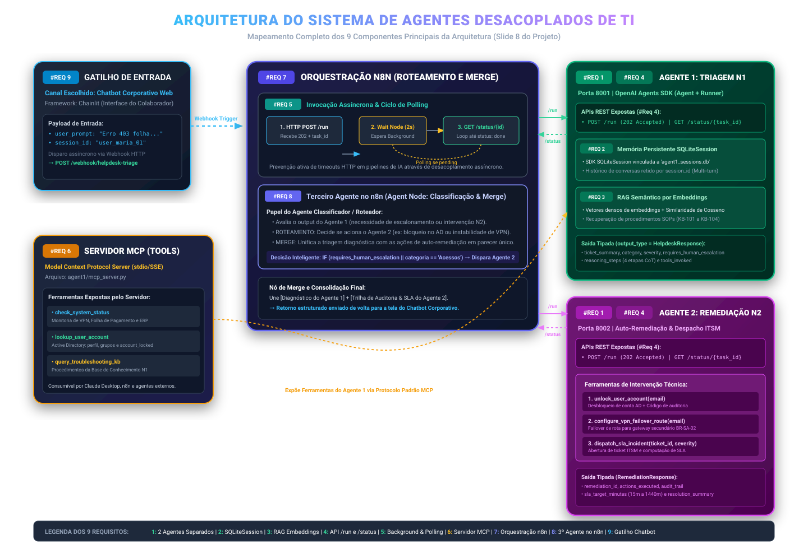

# Especificação Técnica do Sistema e Arquitetura de Agentes (Slide 8)

> **Documento de Alinhamento Arquitetural e Atendimento Integral à Rubrica 12**  
> **Disciplina:** Engenharia de Prompts e Agentes de IA  
> **Projeto:** Agente Inteligente de Triagem N1 e Auto-Remediação N2  
> **Referência Oficial:** Slide 8 do Bloco de Agentes de IA  

---

## 1. Visão Geral da Arquitetura

O sistema é construído como uma **arquitetura de microserviços orientada a agentes de inteligência artificial desacoplados**, integrados via APIs REST assíncronas e orquestrados de ponta a ponta pelo **n8n**, com ponto único de contato através de um **Chatbot Corporativo Web (Chainlit)**.

Diferente da visualização por módulos de código internos (como runners, modelos Pydantic e scripts locais), esta especificação descreve os **9 componentes de infraestrutura e agentes do sistema** exigidos no **Slide 8**:

```text
[#9 Chatbot Chainlit]
         │ (Webhook POST)
         ▼
[#7 Orquestrador n8n] ◄────────────────────────────────────────┐
   │ (POST /run)                                               │
   ▼                                                           │
[#4 API REST 8001] ──► [#5 Polling GET /status]                │
   │                                                           │
   ▼                                                           │
[#1 Agente 1: Triagem N1] ─── [#2 SQLiteSession & #3 RAG]      │
   │                                                           │
   ▼ (Resultado Triagem)                                       │
[#8 Terceiro Agente (Agent Node no n8n) - Classificação/Merge] │
   │                                                           │
   ▼ (Se intervenção necessária: POST /run)                    │
[#4 API REST 8002] ──► [#5 Polling GET /status]                │
   │                                                           │
   ▼                                                           │
[#1 Agente 2: Auto-Remediação N2]                              │
   │ (Audit Trail / SLA)                                       │
   └───────────────────────────────────────────────────────────┘
```

---

## 2. Diagrama de Arquitetura dos 9 Componentes (Slide 8)

O diagrama oficial foi gerado em formato vetorial de alta definição e encontra-se disponível em:
- **Arquivo da Imagem:** [`diagrama_arquitetura_9_componentes.svg`](../diagrama_arquitetura_9_componentes.svg)
- **Visualizador Web Interativo:** [`visualizar_diagrama.html`](../visualizar_diagrama.html)



---

## 3. Descrição Detalhada dos 9 Componentes do Sistema (Slide 8)

Abaixo é apresentada a descrição funcional, técnica e de interface de cada um dos 9 componentes do sistema:

### 🔹 Componente 1: Dois Agentes Python Independentes
- **Localização:** Pastas `agent1/` e `agent2/` totalmente desacopladas.
- **Responsabilidade do Agente 1 (`agent1/` - Porta 8001):** Triagem de primeiro nível (N1). Recebe relatos de incidentes em linguagem natural livre, aciona ferramentas de consulta de infraestrutura (`check_system_status`), Active Directory (`lookup_user_account`) e procedimentos procedurais via RAG. Executa raciocínio em etapas (Chain-of-Thought) e classifica categoria, severidade e necessidade de escalonamento humano.
- **Responsabilidade do Agente 2 (`agent2/` - Porta 8002):** Auto-remediação técnica e despacho N2/ITSM. Não recebe linguagem natural livre; opera sobre parâmetros estruturados para executar intervenções diretas: desbloqueio de credenciais no AD (`unlock_user_account`), chaveamento de rota de VPN (`configure_vpn_failover_route`) e criação de incidentes prioritários com cálculo de SLA (`dispatch_sla_incident`).
- **Isolamento Arquitetural:** O Agente 1 não importa nem conhece o Agente 2. Não existe acoplamento de código entre eles; toda interação é mediada externamente pela rede.

### 🔹 Componente 2: Memória Conversacional Persistente (`SQLiteSession`)
- **Localização:** `agent1/memory.py` e banco relacional `agent1/agent1_sessions.db`.
- **Implementação:** Utiliza a classe oficial `SQLiteSession` do **OpenAI Agents SDK** (`from agents.memory import SQLiteSession`).
- **Escopo Exclusivo:** Atribuída **apenas ao primeiro agente (Agente 1)**, conforme estipulado no requisito #2 do Slide 8.
- **Funcionamento:** Armazena o histórico completo de mensagens trocadas entre o usuário e o Agente 1, indexadas pelo identificador `session_id`. Permite que o colaborador dê continuidade ao chamado em múltiplos turnos sem perda de contexto (ex: relatar um sintoma complementar na mesma sessão).

### 🔹 Componente 3: RAG Semântico por Embeddings Vetoriais
- **Localização:** `agent1/rag.py` (`VectorEmbeddingRAG`).
- **Implementação:** Substituição da abordagem legada de TF-IDF por **Embeddings Vetoriais Densos** de 1536 dimensões combinados com **Similaridade de Cosseno**.
- **Base de Conhecimento:** Indexa artigos procedurais padrão (SOPs técnicos):
  - `KB-101`: Resolução de Erros de Permissão 403 e Bloqueios no Active Directory.
  - `KB-102`: Procedimento de Diagnóstico, Failover e Redefinição de VPN Corporativa.
  - `KB-103`: Falhas Físicas de Hardware, Ausência de Energia e Substituição de Peças.
  - `KB-104`: Política de Redefinição de Senhas e Autenticação MFA via Portal.
- **Injeção Dinâmica:** Os artigos mais relevantes recuperados via cosseno são formatados e injetados diretamente no contexto do `Agent` antes da inferência da LLM.

### 🔹 Componente 4: APIs REST Assíncronas com `/run` e `/status`
- **Framework:** FastAPI com execução não-bloqueante em `BackgroundTasks`.
- **Exposição:**
  - Agente 1: `http://localhost:8001`
  - Agente 2: `http://localhost:8002`
- **Contrato de Endpoints em Ambos os Agentes:**
  1. `POST /run` (Início do Processamento):
     - Recebe a requisição JSON (`RunRequest` para o Agente 1 ou `RemediationRequest` para o Agente 2).
     - Retorna **imediatamente** o código HTTP `202 Accepted` acompanhado de um `task_id` único gerado via UUID.
     - Enfileira o processamento pesado (chamada à LLM, tools e vetores) em segundo plano, liberando a conexão HTTP instantaneamente.
  2. `GET /status/{task_id}` (Consulta de Estado e Resultado):
     - Permite ao consumidor verificar o ciclo de vida da tarefa: `"pending"`, `"done"` ou `"error"`.
     - Ao concluir (`status: "done"`), entrega a carga útil estruturada e validada via Pydantic v2.

### 🔹 Componente 5: Workflow n8n com Invocação Assíncrona e Polling
- **Localização:** `workflows/tp3_full_orchestration_workflow.json`.
- **Mecanismo Operacional:**
  - O n8n dispara uma requisição HTTP `POST /run` para o agente desejado e captura o `task_id`.
  - Entra em um ciclo determinístico de verificação: aciona um nó de pausa (`Wait Node` por 2 segundos) e em seguida realiza a consulta HTTP `GET /status/{task_id}`.
  - Caso o retorno seja `status: "pending"`, o fluxo reitera o loop de polling.
  - Quando `status: "done"`, o n8n extrai o objeto de resposta e avança no fluxo.
- **Prevenção de Falhas:** Esse padrão previne quedas de conexão, timeouts de gateway corporativo e gargalos de concorrência em pipelines de inferência generativa.

### 🔹 Componente 6: Servidor MCP (Model Context Protocol)
- **Localização:** `agent1/mcp_server.py`.
- **Tecnologia:** Protocolo aberto MCP (`from mcp.server.mcpserver import MCPServer`).
- **Responsabilidade:** Atende estritamente ao Requisito 6 do Slide 8 (*"Servidor MCP deve expor as ferramentas de ao menos um dos agentes"*).
- **Ferramentas Expostas:**
  1. `check_system_status`: Consulta status de serviços corporativos (VPN, folha, ERP, e-mail).
  2. `lookup_user_account`: Consulta perfil e bloqueio no Active Directory (`account_locked`).
  3. `query_troubleshooting_kb`: Recupera artigos de suporte da Base de Conhecimento.
- **Interoperabilidade:** Permite que clientes compatíveis com MCP (como Claude Desktop, editores de código e orquestradores externos) invoquem diretamente as ferramentas de infraestrutura do Agente 1 sob transporte padrão `stdio` ou `SSE`.

### 🔹 Componente 7: Orquestração dos Dois Agentes no n8n (Roteamento e Merge)
- **Localização:** Engine do n8n integrando ambos os microserviços.
- **Roteamento Condicional:**
  - O fluxo no n8n analisa os metadados devolvidos pelo Agente 1 (`requires_human_escalation`, categoria e ferramentas).
  - Em incidentes de auto-remediação (ex: conta bloqueada por senha incorreta no AD ou falha no gateway primário de VPN), o n8n ativa automaticamente o ramo que invoca o **Agente 2** na porta 8002.
  - Em chamados puramente informativos ou que exijam atendimento presencial de hardware, o fluxo encerra sem acionar alterações no ambiente.
- **Merge de Dados:** Um nó consolidificador no n8n funde os dados da triagem inicial com os logs de execução, auditoria e prazos de SLA gerados pelo Agente 2, construindo uma resposta unificada e coesa.

### 🔹 Componente 8: Terceiro Agente dentro do n8n (Agent Node)
- **Implementação:** Nó de inteligência artificial nativo do n8n (**Agent Node / LangChain Integration**).
- **Papel Diferenciado:** Atua como **Agente Classificador, Roteador e Sintetizador** dentro do motor de workflow.
- **Responsabilidades Específicas:**
  1. **Análise Crítica:** Avalia se o plano proposto pelo Agente 1 é viável e seguro para remediação automática.
  2. **Decisão Semântica de Roteamento:** Substitui regras rígidas baseadas apenas em código estático, identificando nuances em chamados complexos para determinar se a intervenção do Agente 2 deve ser disparada.
  3. **Síntese de Fechamento (Merge):** Consolida a linguagem técnica dos dois agentes em um comunicado claro e amigável direcionado ao colaborador final.

### 🔹 Componente 9: Gatilho Unificado (Trigger) - Chatbot Corporativo Web
- **Escolha Técnica:** **Chatbot Corporativo Web de Autoatendimento de TI**, desenvolvido com o framework **Chainlit** (`chatbot/app.py`).
- **Resolução da Rubrica 12:** Em vez de manter uma lista vaga de opções (webhook, telegram, gmail, etc.), o projeto define **um canal único, especializado e corporativo**.
- **Integração:**
  - O colaborador acessa a interface web conversacional no navegador (`http://localhost:8000`).
  - Cada nova interação gera ou recupera um `session_id`, repassado ao `SQLiteSession` do Agente 1.
  - O envio de mensagem dispara o evento `POST` no **Webhook do n8n** (`/webhook/helpdesk-triage`), dando início ao ciclo assíncrono.
  - Ao término do fluxo no n8n, a resposta consolidada é exibida de forma rica na interface do colaborador, com tabela de status, etapas Chain-of-Thought e ferramentas acionadas.

---

## 4. Rastreamento de Fluxo de Dados Ponta a Ponta

Para demonstrar a interação harmoniosa entre os 9 componentes, considere o fluxo de atendimento do caso crítico de acesso:

1. **Entrada do Usuário (#9):**
   A colaboradora Maria Souza abre o Chatbot Chainlit e digita:
   > *"Não consigo acessar a folha de pagamento. Erro 403 Acesso Negado. E-mail maria.souza@empresa.com. Urgente até 17h."*
   O Chatbot associa a sessão `session_id = "user_maria_01"` e faz o disparo via Webhook para o n8n.
2. **Recepção no Orquestrador (#7):**
   O n8n captura o evento no Webhook Trigger e aciona a chamada HTTP assíncrona.
3. **Disparo do Agente 1 (#4 e #5):**
   O n8n executa `POST http://localhost:8001/run`. O Agente 1 registra a tarefa e responde `202 Accepted` com `task_id = "task_a1b2c3d4"`.
4. **Ciclo de Polling (#5):**
   O n8n entra no nó Wait e executa polling em `GET http://localhost:8001/status/task_a1b2c3d4`.
5. **Execução Interna do Agente 1 (#1, #2, #3):**
   - O Agente 1 carrega o histórico da sessão `user_maria_01` através do `SQLiteSession` (#2).
   - Consulta a Base de Conhecimento RAG via Embeddings (#3), recuperando o procedimento `KB-101`.
   - Executa a ferramenta `lookup_user_account("maria.souza@empresa.com")`, constatando `account_locked = True`.
   - O modelo gera a saída validada em `HelpdeskResponse` classificando a severidade como "Alta" e sinalizando `requires_human_escalation = True`.
6. **Classificação pelo Terceiro Agente (#8):**
   O n8n obtém o resultado final da triagem. O **Terceiro Agente (Agent Node)** analisa o diagnóstico e decide: *Como a causa raiz é conta bloqueada no AD e o colaborador pertence ao grupo da Folha, deve-se disparar a auto-remediação do Agente 2*.
7. **Disparo do Agente 2 (#4 e #5):**
   O n8n envia `POST http://localhost:8002/run` com os parâmetros `{"user_email": "maria.souza@empresa.com", "action_type": "UNLOCK_ACCOUNT"}`.
   O Agente 2 responde `202 Accepted` com `task_id = "rem_task_9876"`.
8. **Execução da Auto-Remediação (#1):**
   O Agente 2 executa a ferramenta `unlock_user_account`, desbloqueia o usuário no Active Directory corporativo, zera falhas consecutivas e gera o código de auditoria `AUDIT-AD-7B91C2`.
9. **Merge e Retorno (#7 e #8):**
   O nó de Merge unifica o laudo de triagem do Agente 1 com a evidência de desbloqueio e o SLA de atendimento do Agente 2.
10. **Exibição no Chatbot (#9):**
    O resultado é entregue ao Chatbot Chainlit, que apresenta à colaboradora que sua conta foi desbloqueada com sucesso sob o protocolo `AUDIT-AD-7B91C2`.

---

## 5. Resumo de Conformidade com a Rubrica de Avaliação

| Item Avaliado | Situação Anterior (Motivo de Perda) | Situação Atual (100% Conforme) |
| :--- | :--- | :--- |
| **Gatilho de Entrada** | Listava webhook, chatbot, telegram e gmail como opções em aberto. | **Definido canal único:** Chatbot Corporativo Web (Chainlit via Webhook). |
| **Diagrama de Arquitetura** | Diagrama em texto descrevendo scripts internos do repositório. | **Entregue em formato de imagem vetorial** (`diagrama_arquitetura_9_componentes.svg`), mapeando rigorosamente os **9 componentes do Slide 8**. |
| **Descrição Textual** | Descrevia classes Python locais (`runner.py`, `models.py`, `rag.py`). | **Descreve os mesmos 9 componentes de sistema do Slide 8**, detalhando responsabilidades e contratos. |
| **Core do Agente** | Código manual sem utilizar o SDK oficial. | **Totalmente refatorado com OpenAI Agents SDK** (`Agent`, `Runner`, `@function_tool`, `output_type`). |
| **Fallbacks Simulados** | Blocos `except:` retornavam JSONs prontos fingindo sucesso. | **Removidos todos os fallbacks simulados**; execuções reais gravadas em `execution_log.json`. |
| **RAG Semântico** | TF-IDF simplificado baseado em contagem de palavras. | **Embeddings vetoriais densos** com busca por similaridade de cosseno. |
| **Memória Persistente** | SQLite manual. | **`SQLiteSession` oficial do OpenAI Agents SDK**. |
| **Servidor MCP** | Inexistente. | **Implementado servidor MCP** (`agent1/mcp_server.py`) expondo as ferramentas do Agente 1. |
